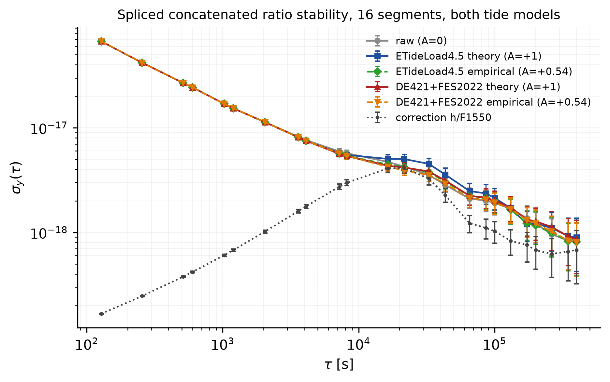

# Spliced concatenated stability (16-segment primary, both tide models)

16 segments placed end-to-end on one continuous 1-s clock; the wall-clock gaps are removed. The aligned record spans **986,416** s (11.417 d of pure data time) versus 57.97 d of real elapsed time. One OADEV per series over the aligned axis, starting at tau = 100 s. Template sign follows the paper convention (corrected for the beat polarity; positive amplitude = expected response).

| tau [s] | tau [d] | raw (A=0) | ETideLoad4.5 theory (A=+1) | ETideLoad4.5 empirical (A=+0.54) | DE421+FES2022 theory (A=+1) | DE421+FES2022 empirical (A=+0.54) | correction h/F1550 | n_pairs |
|---|---|---|---|---|---|---|---|---|
| 128 | 0.001 | 6.699e-17 ± 5.4e-19 | 6.699e-17 ± 5.4e-19 | 6.699e-17 ± 5.4e-19 | 6.699e-17 ± 5.4e-19 | 6.699e-17 ± 5.4e-19 | 1.667e-19 ± 1.3e-21 | 986161 |
| 256 | 0.003 | 4.180e-17 ± 4.8e-19 | 4.180e-17 ± 4.8e-19 | 4.180e-17 ± 4.8e-19 | 4.180e-17 ± 4.8e-19 | 4.180e-17 ± 4.8e-19 | 2.465e-19 ± 2.8e-21 | 985905 |
| 512 | 0.006 | 2.688e-17 ± 4.3e-19 | 2.688e-17 ± 4.3e-19 | 2.688e-17 ± 4.3e-19 | 2.688e-17 ± 4.3e-19 | 2.688e-17 ± 4.3e-19 | 3.769e-19 ± 6.1e-21 | 985393 |
| 600 | 0.007 | 2.435e-17 ± 4.2e-19 | 2.435e-17 ± 4.2e-19 | 2.435e-17 ± 4.2e-19 | 2.436e-17 ± 4.2e-19 | 2.435e-17 ± 4.2e-19 | 4.180e-19 ± 7.3e-21 | 985217 |
| 1024 | 0.012 | 1.694e-17 ± 3.9e-19 | 1.695e-17 ± 3.9e-19 | 1.694e-17 ± 3.9e-19 | 1.695e-17 ± 3.9e-19 | 1.694e-17 ± 3.9e-19 | 6.040e-19 ± 1.4e-20 | 984369 |
| 1200 | 0.014 | 1.532e-17 ± 3.8e-19 | 1.532e-17 ± 3.8e-19 | 1.532e-17 ± 3.8e-19 | 1.532e-17 ± 3.8e-19 | 1.532e-17 ± 3.8e-19 | 6.777e-19 ± 1.7e-20 | 984017 |
| 2048 | 0.024 | 1.133e-17 ± 3.7e-19 | 1.129e-17 ± 3.6e-19 | 1.130e-17 ± 3.6e-19 | 1.130e-17 ± 3.6e-19 | 1.131e-17 ± 3.6e-19 | 1.018e-18 ± 3.3e-20 | 982321 |
| 3600 | 0.042 | 8.200e-18 ± 3.5e-19 | 8.121e-18 ± 3.5e-19 | 8.118e-18 ± 3.5e-19 | 8.124e-18 ± 3.5e-19 | 8.135e-18 ± 3.5e-19 | 1.596e-18 ± 6.8e-20 | 979217 |
| 4096 | 0.047 | 7.618e-18 ± 3.5e-19 | 7.513e-18 ± 3.4e-19 | 7.510e-18 ± 3.4e-19 | 7.510e-18 ± 3.4e-19 | 7.528e-18 ± 3.4e-19 | 1.770e-18 ± 8.1e-20 | 978225 |
| 7200 | 0.083 | 5.946e-18 ± 3.6e-19 | 5.728e-18 ± 3.5e-19 | 5.668e-18 ± 3.4e-19 | 5.627e-18 ± 3.4e-19 | 5.676e-18 ± 3.4e-19 | 2.727e-18 ± 1.7e-19 | 972017 |
| 8192 | 0.095 | 5.712e-18 ± 3.7e-19 | 5.505e-18 ± 3.6e-19 | 5.400e-18 ± 3.5e-19 | 5.349e-18 ± 3.5e-19 | 5.395e-18 ± 3.5e-19 | 2.980e-18 ± 1.9e-19 | 970033 |
| 16384 | 0.190 | 4.714e-18 ± 4.3e-19 | 5.039e-18 ± 4.6e-19 | 4.446e-18 ± 4.1e-19 | 4.333e-18 ± 4.0e-19 | 4.235e-18 ± 3.9e-19 | 4.096e-18 ± 3.8e-19 | 953649 |
| 21600 | 0.250 | 4.256e-18 ± 4.5e-19 | 5.021e-18 ± 5.3e-19 | 4.211e-18 ± 4.4e-19 | 4.168e-18 ± 4.4e-19 | 3.925e-18 ± 4.1e-19 | 4.117e-18 ± 4.3e-19 | 943217 |
| 32768 | 0.379 | 3.539e-18 ± 4.6e-19 | 4.519e-18 ± 5.9e-19 | 3.760e-18 ± 4.9e-19 | 3.828e-18 ± 5.0e-19 | 3.526e-18 ± 4.6e-19 | 3.269e-18 ± 4.3e-19 | 920881 |
| 43200 | 0.500 | 2.845e-18 ± 4.3e-19 | 3.578e-18 ± 5.4e-19 | 3.057e-18 ± 4.6e-19 | 3.137e-18 ± 4.7e-19 | 2.917e-18 ± 4.4e-19 | 2.277e-18 ± 3.4e-19 | 900017 |
| 65536 | 0.759 | 2.096e-18 ± 3.9e-19 | 2.480e-18 ± 4.6e-19 | 2.230e-18 ± 4.2e-19 | 2.234e-18 ± 4.2e-19 | 2.133e-18 ± 4.0e-19 | 1.216e-18 ± 2.3e-19 | 855345 |
| 86400 | 1.000 | 2.015e-18 ± 4.3e-19 | 2.357e-18 ± 5.1e-19 | 2.137e-18 ± 4.6e-19 | 2.146e-18 ± 4.6e-19 | 2.049e-18 ± 4.4e-19 | 1.104e-18 ± 2.4e-19 | 813617 |
| 100000 | 1.157 | 1.909e-18 ± 4.5e-19 | 2.131e-18 ± 5.0e-19 | 1.966e-18 ± 4.6e-19 | 2.010e-18 ± 4.7e-19 | 1.930e-18 ± 4.5e-19 | 1.028e-18 ± 2.4e-19 | 786417 |
| 131072 | 1.517 | 1.680e-18 ± 4.5e-19 | 1.705e-18 ± 4.6e-19 | 1.642e-18 ± 4.4e-19 | 1.732e-18 ± 4.7e-19 | 1.676e-18 ± 4.5e-19 | 8.294e-19 ± 2.2e-19 | 724273 |
| 172800 | 2.000 | 1.366e-18 ± 4.3e-19 | 1.201e-18 ± 3.8e-19 | 1.222e-18 ± 3.8e-19 | 1.326e-18 ± 4.2e-19 | 1.308e-18 ± 4.1e-19 | 7.582e-19 ± 2.4e-19 | 640817 |
| 200000 | 2.315 | 1.217e-18 ± 4.2e-19 | 1.211e-18 ± 4.1e-19 | 1.166e-18 ± 4.0e-19 | 1.276e-18 ± 4.4e-19 | 1.218e-18 ± 4.2e-19 | 6.760e-19 ± 2.3e-19 | 586417 |
| 262144 | 3.034 | 9.588e-19 ± 3.9e-19 | 1.104e-18 ± 4.4e-19 | 9.924e-19 ± 4.0e-19 | 1.127e-18 ± 4.5e-19 | 1.022e-18 ± 4.1e-19 | 6.219e-19 ± 2.5e-19 | 462129 |
| 345600 | 4.000 | 8.378e-19 ± 4.0e-19 | 9.218e-19 ± 4.4e-19 | 8.215e-19 ± 3.9e-19 | 9.207e-19 ± 4.4e-19 | 8.365e-19 ± 4.0e-19 | 6.558e-19 ± 3.1e-19 | 295217 |
| 400000 | 4.630 | 8.571e-19 ± 4.5e-19 | 8.947e-19 ± 4.7e-19 | 8.096e-19 ± 4.3e-19 | 8.506e-19 ± 4.5e-19 | 8.031e-19 ± 4.2e-19 | 6.796e-19 ± 3.6e-19 | 186417 |

> `u_sigma` is the 1-sigma EDF (Riley & Howe) uncertainty on sigma_y. Gaps are removed, so the record is treated as contiguous; a tau longer than one raw segment is computable but mixes different campaigns, and `n_pairs` records the adjacent m-averaged differences behind each point.

